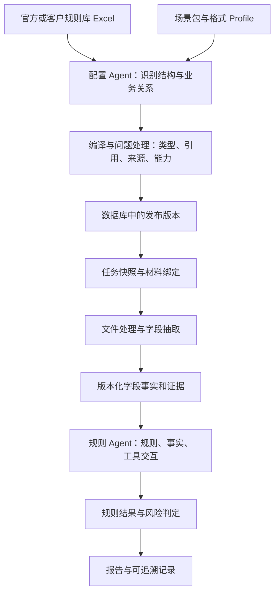
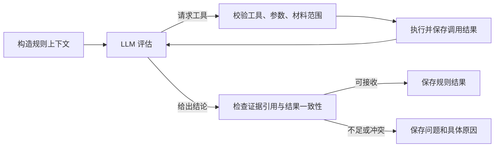
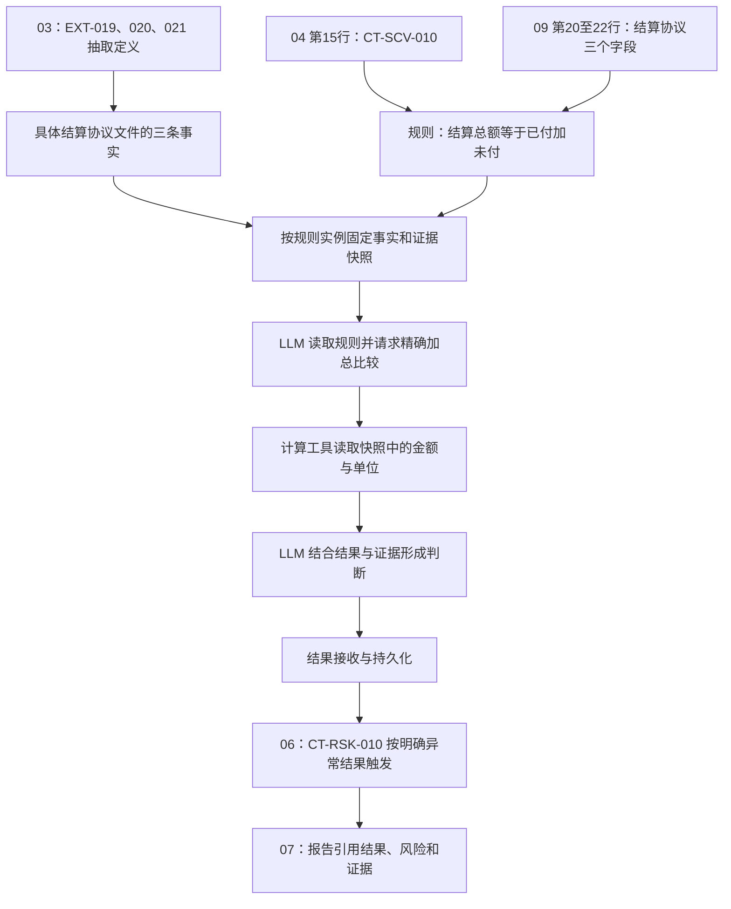

# 场景化审核 Agent：需求与设计评审稿

日期：2026-09-16。状态：待用户评审。本文整理目标方案，不表示已实现、已运行或获准编码。

用户决定先评审方案，认可后再开始项目编写。本文是本轮设计的统一入口；现有实现事实和旧文档冲突记在 [当前状态与问题台账.md](当前状态与问题台账.md)。本文不改变历史配置、任务、业务文件或程序。

## 1. 用户关注与设计对应

第二列既包含用户直接提出的要求，也包含为回答这些问题必须覆盖的设计关注；后两列均为待评审方案，不表示用户已经逐项批准。

| 编号 | 需求/关注 | 设计落点 | 将来如何证明满足（本轮不执行测试） |
| --- | --- | --- | --- |
| R1 | 用 LLM 减少繁琐配置 | 配置 Agent 联合解释工作簿，自动形成有来源的草稿；人工处理业务歧义 | 真实 Excel 无须逐列拖拽；只呈现不能自行消解的问题 |
| R2 | 不同场景内置不同模板，兼容客户 Excel | 场景包、格式 Profile、业务配置版本分离 | 合同和财报可以具有不同字段、维度、流程；改排版不改业务定义 |
| R3 | 明确需要上传哪些文件 | 材料角色、文件绑定、数量与配对策略 | 每个文件能定位业务角色和实际文件版本；不依赖文件名猜测 |
| R4 | 明确每份文件抽取什么、怎么抽、怎样保存 | 字段定义、抽取规范、带证据的类型化事实 | 每个值可回到原文件、原文、产物版本；区分原值、规范值和未知 |
| R5 | 09 Sheet 很关键 | 材料—字段—抽取—校验—风险的显式业务关系来源 | 所有 09 行被处理，每条关系有目标及来源；不能静默丢弃 |
| R6 | 准确寻找规则使用的材料和比较项目 | 发布时形成有角色的输入绑定；运行时解析为具体事实快照 | 同名字段不串材料；同类多文件不取第一份；比较项可追溯 |
| R7 | 多数规则两两对比，也要表达其他规则 | 一元、二元、多元/集合输入；业务原文和条件极性 | 能表达非空、主体比较、日期比较及结算总额与两项加总 |
| R8 | LLM 接收相关字段与规则作审核判断 | 规则 Agent、上下文构造器、工具执行节点、结果接收校验 | 结论有字段/证据/工具引用；错误与不足不伪装为通过 |
| R9 | 节点应有真正的 LangGraph State，并按需调用工具 | 审核主图与抽取/规则子图，分层 State | 能知道当前规则、事实版本、调用进度和未解决事项，并恢复 |
| R10 | 审核前配置已保存到数据库 | 草稿、发布版本、任务快照 | 审核不再读 Excel；新规则版本不改变旧任务 |
| R11 | Sheet 顺序是否等于审核执行顺序 | 建议把合同场景阶段与 01–07 的业务语义对应，08/09 编译为支撑配置；不把物理 Sheet 顺序当作路由依据 | 界面阶段与执行依赖一致；拖动 Sheet 不改变流程 |
| R12 | 不通过对应明确风险等级 | 已发布风险定义与触发条件 | 等级、动作和建议有配置来源；模型不创造等级 |
| R13 | 大文件配置不能写死 | 传输策略与场景业务检查分开 | 前后端同源；不把平台上传限制写成所有业务的审核条件 |
| R14 | JSON 化数据如何保存，MySQL/MongoDB 及现有技术栈是否适合 | 建议保留 MySQL，以关系索引、版本化 JSON、文件存储和独立 checkpoint 分担职责 | 查找与关联有约束，完整配置与历史证据可保存 |
| R15 | 先设计，不编码；真实文件、无模拟成功 | 本文与真实工作簿静态核对 | 不修改业务程序，不启动服务/模型/数据库，不运行测试 |

用户此前第 5 点没有内容，不补成一个新的需求。财报场景尚无用户提供的真实规则库，因此本文给出扩展模型，不声称已完成财报业务设计。

## 2. 总体结构与需纠正的旧说法

建议采用同一套平台内核，分别承担配置理解、文件抽取和规则审核。Agent 是职责划分，不要求三个服务、三个模型或多 Agent 相互聊天。



以下是本稿明确修正的设计口径：

- 场景业务可以不同，但无须为每个场景重写一套 Python 模型和运行引擎。共用材料、字段、关系、判断、风险、报告这些元模型，以场景 Schema、字典及工具能力扩展。
- LLM 负责主要的配置理解与规则审核；不要求用户逐个确认所有映射。只有真正的业务缺失、矛盾和不唯一解释需要回答。
- 冻结业务条件、输入身份、取证范围和能力版本；Agent 仍能根据状态选择具体工具调用步骤。
- 09 的业务关系不同于 Profile 的格式映射。同一 Profile 的下一份工作簿必须重新解析业务内容，不能复制上一份的规则关系。
- 系统已有 State 和 checkpoint；差距在于审核内部缺少完整的模型—工具交互与状态契约，不能描述成“没有 State”。
- 金额/日期工具的可靠结果约束模型判断；模型输出不能任意推翻精确计算。冲突应保留并重新核实原因。
- 风险既可能依据校验结果，也可能直接依据字段条件；不能把所有风险改写成“某条规则失败”。
- 审计回放与重新运行模型不同。保存历史过程可回放；冻结配置、temperature=0 都不能保证再次调用 LLM 得到相同答案。

## 3. 场景与模板：共用内核，分别定义业务

| 概念 | 职责 | 不应混入的内容 |
| --- | --- | --- |
| 场景包 | 业务概念、字段类型/维度、字典、阶段、模板与能力要求 | 某一任务的真实合同金额 |
| Excel Profile | 表/区域/表头对应哪些配置属性，如何读取该种排版 | 上一次上传的规则、阈值、风险关联 |
| 场景配置版本 | 本次导入得到的材料、字段、规则、风险及关系 | 未确认业务口径或自动生成的虚构能力 |
| 审核方案 | 对固定场景版本选择审核范围，并闭合其依赖 | 指向“永远最新”的场景版本 |
| 审核任务 | 指定配置与真实材料的一次审核 | 其他任务、旧文件版本的当前事实 |

合同场景可用标量、主体、日期、金额、条款等字段；财报场景可用期间、主体、科目、合并/母公司口径等维度下的金额或明细集合。同样叫“营业收入”，不同期间或口径也必须有明确选择条件。

内核支持类型化标量、对象、集合与有类型的关系。场景添加字段、字典和模板通常是配置变化；新的算法、无法表达的新对象或新的外部服务才需要开发支持。不能用自由 JSON 声称任何新业务都已可执行。

必须区分“规则配置 Excel”和“待审核财报 Excel”等业务材料。同为 `.xlsx` 不代表用途相同，入口或任务上下文明确用途；无法区分时才让用户选择。

模板生成器读取场景 Schema、Profile 和真实能力目录，生成该场景的表头、说明、引用选项和下拉。合同官方模板保留 01–09 的业务视图，尤其保留 09；页面编辑和 Excel 导入汇入同一配置模型，09 也能由内部已编译关系导出。业务用户无需维护工具 ID、JSON 或数据库主键。

复用 Profile 需确认结构契约仍匹配；布局变化时让配置 Agent 重新识别变化部分。不能因为文件名相同或表头相似就复用上一版业务值。未知场景可以保存新场景草稿，但缺少能力的草稿不能宣称能执行。

## 4. 配置 Agent 如何处理不同 Excel

读取分成两个独立步骤：程序完整保存物理事实，Agent 理解这些事实。

1. 保留工作簿哈希、Sheet、区域、坐标、原始值、单元格类型、格式、公式和合并信息。原始读取不以“已识别某个 v1–v4”作为成功条件。
2. 构造结构目录，识别表头、分组行、说明行、多表区域和业务行。先给 Agent 目录与代表内容，再按需读取完整区域；预览截断不能变成业务行截断。
3. 在场景约束下生成格式映射和对象候选，再读取跨表引用。已知格式可确定性读取，未知格式由 LLM 解释。
4. 合并 01/03/04/05/06/08/09 等来源，产生带类型的关系。不能按 Sheet 顺序先遇到谁就让谁覆盖。
5. 校验引用、输入类型、适用范围、条件极性、字典、能力及来源覆盖。遗漏的业务行必须补读，说明行保留排除原因。
6. 模型因格式或引用错误修正提案时，仍需原文支持；不能为通过校验删除规则、修改等级或补默认值。不可自行解决的问题集中展示。
7. 自动形成配置草稿，用户审阅业务摘要与确实未决事项。发布是对整份版本的操作，不要求每个字段额外审批；按原有发布权限冻结版本。

JSON/外键校验通过只能证明结构成立，不能证明业务理解准确。设计中必须保留逐项来源、解释、补全记录、未映射内容和冲突；模型自评“高置信度”不能替代这些证据。

这里的自动补全仅指已有来源支持的结构信息。例如 09 明确给出某抽取 ID 对应的字段名，Agent 可以补到候选里并标出来源；该行未给出的状态、日期、币种或风险阈值不能一起补出。

## 5. 09 Sheet 与内部关系模型

09 是关键关系来源，全部行均应处理；它不是唯一业务权威，也不是审核的第九步。格式映射与业务关系分别持久化。

| 内部关系 | 含义 | 主要来源 |
| --- | --- | --- |
| 材料包含字段 | 字段定义属于哪个材料角色 | 03、09 |
| 抽取产生字段 | 怎样从材料取得字段 | 03、09 |
| 规则输入 | 字段/产物在规则中是哪个输入角色 | 04/05 正文及 09 参与关系 |
| 规则适用范围 | 对哪些材料、组合和条件执行 | 01、02、04、05、09 |
| 风险触发条件 | 哪些规则结论或字段条件使风险成立 | 06 的明确条件 |
| 风险背景关联 | 某字段与某风险有关，但不代表能触发 | 09 的关联风险列，结合 06 核对 |
| 报告引用 | 哪些材料/字段/结果展示在哪个章节 | 07，结合材料与字段目录 |

每条关系保存两端内部 ID、关系类型、输入角色/选择条件、适用范围及全部来源坐标。显式读取、程序可验证的推导、LLM 推断、用户决定要能区分。

规则以有角色的 `inputs` 表达一元/二元/多元输入，引用类型可为字段事实、文件属性、产物或常量。自然语言规则原文必须保留；能明确形式化的部分另存有类型的条件树，不执行字符串 `eval`，也不强迫每条语义规则变成算子表达式。

重点处理条件极性：`为空` 往往是失败条件，`A=B` 往往是通过条件。内部同时记录原文、条件指向及规范化判断要求；不能把某列所有句子一律解释为通过条件。

来源冲突不设“09 永远覆盖 03”或“06 永远覆盖其他等级”的通用优先级。能兼容的互补信息合并；矛盾、显式否定或组合语义不清时保留冲突。`-`、斜杠、编号区间的解释属于该 Profile 的源格式契约，未定义时不默认成忽略、任选或全部。

草稿建立对象时即由系统分配稳定身份，发布时冻结其版本；来源编号保存为 `source_ref`。已有对象在新版本中的身份通过明确的修订映射延续，不能因移动 Excel 行、改显示名或文件哈希变化而重新生成全部业务身份。来源坐标用于证据，不是业务主键。

## 6. 文件、字段和规则实例怎样准确绑定

绑定分三层：

```text
字段定义属于材料角色
真实文件版本绑定材料实例
规则输入解析为本任务、本组材料中的具体事实版本
```

材料角色是“主合同/补充协议/结算协议”；材料实例是某一份具体业务材料；文件版本是该实例的一次上传。文件名、文件哈希均不能代替业务角色。用户在明确槽位上传时获得显式绑定；批量上传可由 Agent 提出分类、关联候选，有歧义时只确认该绑定。

上传策略、业务材料角色和 8018 的外部识别类型分别保存。业务字典中的“主合同”不是外部服务枚举；外部映射依据真实服务契约，失败如实暴露。

这份 Excel 未声明每种材料数量，也未声明多主合同的配对规则，因此不能把“一行材料定义”推断成“只允许一份文件”。建议模型预留材料实例及关系：一份主合同与其补充/结算协议属于同一合同组。匹配需要配置依据与唯一性，不能任取第一份，也不能对所有文件做笛卡尔积。

`原合同编号` 可作为配对候选依据，但“建立关联”与“业务校验编号一致”不同。不得仅因备注写了“关联主键”就增加 Excel 未定义的审核规则。合同场景实际数量和配对策略保留为业务待确认。

一条规则定义可以产生多个规则实例，例如通用签章规则作用于不同材料；实例身份包括规则版本、材料实例组合及作用域。每次评估再绑定输入修订和具体事实 ID。这样多份材料的结果不会被一个 `rule_key` 覆盖。

同文件规则解析该材料实例的字段；跨文件规则先解析材料关系，再取字段；财报规则还需解析期间、科目、口径。名称只用于展示和导入时的语义理解，运行检索使用已绑定的身份与选择条件。

## 7. 字段如何抽取、表达和更新

字段定义包含材料角色、业务含义、值 Schema、抽取要求、规范化口径、所需产物、必抽要求及失败处理。抽取规范可以由 LLM 根据规则库自动整理，但不能把提取目标扩成原文没有要求的金额口径或主体含义。

| 值类型 | 规范值建议 | 必须另存的信息 |
| --- | --- | --- |
| 文本/编号/主体 | 保留有据可查的文本，规范化规则版本明确 | 原始文本、大小写/空格等变换记录；不把“统一全称”变成编造全称 |
| 金额/数值 | JSON 中用十进制字符串；单位、币种独立属性 | 原值与证据精度；缺币种不默认人民币；显示两位小数不自动成为计算舍入规则 |
| 日期 | 完整日期可表示为 `YYYY-MM-DD` | 原文、精度、多个日期候选；缺月/日不能自动补齐 |
| 条款 | 存在性、条款原文及必要结构字段 | 已覆盖范围；没搜到不自动等于不存在 |
| 明细/集合 | 类型化条目列表和维度 | 每条记录的原始表格位置、所属材料及期间/主体等范围 |

每条事实保存字段定义版本、材料实例与文件版本、产物版本、原值、规范值、状态、证据引用、模型/提示词版本和抽取批次。页码/坐标仅保存真实可定位信息，缺失时明确为空。

“必抽”要求执行抽取并得到可解释结果，不等于合同必须包含该条款。字段缺失要区分证实未出现、未找到、读取失败、多个候选冲突；`禁止转让条款=无` 必须有适当的覆盖依据，不能以空值替代。

字段抽取可按同文件相近字段批量进行；每个字段结果独立保存。规则 Agent 可读取绑定文件的相关页面、请求重抽取已配置字段，不能因“只提供当前字段”而禁止正常补证。新增事实先形成候选，按统一规则选用当前事实；变更后失效依赖的规则、风险和报告。

规则评估开始时冻结实际输入事实集合。评估期间不能每次工具调用都读“最新事实”；如果输入修订改变，该次评估保留为历史/失效，重新组装一致的输入后评估。

## 8. LangGraph 主图、子图和工具调用

合同场景外层阶段沿 01–07：材料检查、质量与文档准备、字段抽取、内部校验、交叉校验、风险、报告。08/09 在发布前编译完成。阶段内可有独立的抽取或规则评估子图；规则实例是隔离单位，不要求所有规则只能串行或每个字段都单独调用模型。

阶段顺序与资源依赖要同时成立。例如质量阶段的清晰度/签章可能依赖页面或识别产物，应在该阶段按需准备并复用；若规则需要尚未定义的主体输入，先形成依赖缺口，不能空跑第二阶段或宣称第三阶段已完成。

前文“每个节点都要求人点击确认”不应成为新方案默认交互。建议无未决问题时自动推进；确需人回答的事实、业务或绑定问题通过 interrupt 暂停，回复后从对应状态恢复。人工复核可以在有依赖的阶段发生，不必等所有规则执行完才纠正上游事实。



LLM 是业务判断主体。金额、日期、加总、真实文件属性由确定性工具提供可核对事实；语义规则保留业务语言。若精确计算和模型结论相反，保存两者与冲突，核对取值、单位和条件后重新评估；不得覆盖计算结果或包装成通过。网络/API/工具异常独立记录为执行错误。

工具目录统一声明 ID、版本、用途、输入输出 Schema、产物依赖、适用范围、实际 handler、可观测错误、是否有外部副作用、幂等/查询支持。能在当前规则范围内调用哪些能力由已发布策略和真实目录导出，不让用户逐条手写工具名单。

Agent 可按 State 决定调用步骤。服务端把任务、文件修订和规则范围绑定到工具上下文；不能仅在提示词中要求模型“不越界”。调用参数尽量引用事实/证据 ID，数值由系统解析，避免模型抄错金额后算对了另一道题。

本项目 LLM 适配器当前只收发 JSON 文本。目标需接入模型工具调用响应、调用 ID、工具结果返回与继续推理循环；`ToolNode` 是一种实现方式，不能仅凭是否用了该类判断 Agent 是否成立。当前模型供应商的工具调用与结构化输出能力尚未实际验证，部署前需按真实契约确认，不能用提示词宣称已支持。

## 9. State、数据库、检查点各保存什么

State 是可恢复的运行进度；数据库保存领域事实。建议分层，而不是把整个工作簿和全任务对话反复塞进一个 State。

### 当前 State 与目标 Agent State 的边界

当前代码并非没有 State：`ImportGraphState` 保存 WorkbookIR、映射提案、裁决和 manifest，`AuditGraphState` 保存任务、节点、阶段、人工复核和错误引用，二者都由 LangGraph `StateGraph` 驱动并可使用 MySQL checkpoint。它们目前主要是流程控制状态。

当前 `AuditGraphState` 尚未表达规则 Agent 所需的 `messages`、规则实例、固定事实快照、工具目录/策略版本、`tool_call_id`、调用参数与结果、待处理调用、候选结论及循环进度；现有审核图的条件边也仍是固定节点边，并在每个节点前等待确认。已有 `operators.REGISTRY` 是确定性算子处理表，不等于模型可调用的通用工具目录。

目标的规则评估 State 至少应能表达：

```text
evaluation_id / rule_instance_id
config_version / input_fact_snapshot
messages / pending_tool_calls / tool_results
candidate_verdict / evidence_refs / unresolved_reasons
operation_ids / retry-or-reconcile status
```

因此“按 State 调工具”不是给现有 State 再加一个布尔字段，而是增加规则/抽取子图的状态契约和模型—工具—结果循环。现有流程 State、数据库事实和 checkpoint 应复用，但不能把已有 checkpoint 当成工具 Agent 已经实现的证据。

| 层 | State 中的核心信息 | 完整内容存放位置 |
| --- | --- | --- |
| 配置导入图 | 导入 ID、源文件哈希、已处理区域、映射修订、候选/问题引用、当前阶段 | Workbook 片段、对象、关系和来源记录 |
| 审核主图 | 任务/发布版本、输入修订、当前阶段、完成实例、阻塞问题、子图引用 | 任务快照、文件绑定、节点执行记录 |
| 字段抽取子图 | 材料/文件/产物版本、字段批次、证据范围、调用进度、事实候选引用 | 抽取结果与证据 |
| 规则评估子图 | 规则实例/评估 ID、输入快照、活动字段/证据、工具策略版本、消息/调用状态、结论及问题引用 | 不可变评估输入、模型响应、工具记录、接收结果 |

子图保留必要的活动消息和模型工具调用关系；大对象用版本化引用。每次恢复读取的是同一引用，不通过查询最新对象改变历史执行。数据库 Session、HTTP 客户端和密钥放运行依赖上下文，不进入持久化 State。

每个节点返回明确的 State 更新；并行分支按规则实例/调用 ID 合并结果，定义 reducer 或隔离子图状态，不能多分支覆盖同一个 `verdict`/消息列表。工具请求与结果用相同调用 ID 关联，步骤可追踪但不要求保存或展示模型隐藏推理。

State 能检查当前是否有待处理调用、待接收结论或待回答问题。重复调用若没有新增证据、输入或结果变化，要显式记录重复/无进展及原因；不要靠隐藏重试或固定“跑满若干轮就返回通过”结束。

状态建议分开记录，名称是设计语义，最终枚举待实现契约确定：

| 维度 | 含义 |
| --- | --- |
| 执行状态 | 待执行、执行中、已完成、技术失败、结果未知 |
| 规则结论 | 通过、不通过、无法判断、不适用 |
| 复核状态 | 无需复核、待复核、已复核 |
| 风险成立状态 | 成立、不成立、无法判断、不适用 |
| 风险等级 | 来自配置的业务等级，不能由执行状态推算 |
| 当前有效性 | 结果是否仍适用于当前配置、文件和事实修订 |

`待复核` 不能覆盖原来的系统不通过结论；技术失败不能转为“正常执行但无法判断”并悄悄完成。可选材料缺失只有满足规则适用条件时才是不适用；检查“材料是否缺失”的规则仍可产生结论。

## 10. 存储、发布与恢复

推荐继续使用 MySQL + 文件存储，不因 JSON 增多引入 MongoDB。以下是概念存储职责，不是本轮数据库 DDL 或每个概念必须独占一张表。

| 保存内容 | 建议结构与查询键 |
| --- | --- |
| 原始规则库和真实材料 | 文件存储；数据库存内容哈希、大小、位置、修订 |
| 原始表格与导入来源 | 工作簿/Sheet/区域分片 JSON，加来源坐标索引 |
| 格式映射 | 独立 Profile/MappingPlan 版本，记录格式解释及依据 |
| 配置草稿与业务关系 | 对象身份和关系用关系索引，可变规范用类型化 JSON |
| 发布配置 | 不可变版本 JSON、Schema/能力版本及哈希；关系表作为同版本查询投影 |
| 任务与材料绑定 | 任务 ID、配置版本、输入修订、材料实例、文件版本、配对关系 |
| 字段事实/证据 | 事实 ID、字段版本、材料实例、文件/产物版本；值与证据独立版本化 |
| 模型和工具调用 | 调用 ID、输入快照/哈希、结果、工具/模型版本、外部作业号、错误 |
| 规则/风险/报告 | 规则实例、评估批次、确切来源结果 ID、有效性、证据引用 |
| LangGraph checkpoint | 可恢复的图状态，与上述业务对象通过 ID 和修订对账 |

配置草稿编译为单一内容版本；发布时事务保存版本及其查询投影。任务引用不可变版本及所选范围的快照；关系投影不能独立编辑成另一套配置。变更应生成新版本，不能让运行时在 JSON 与关系表中随意挑一个。

大 IR、模型响应与列表摘要分开读取；常用关联键建立普通列和索引，不把所有依赖藏在一个巨型 JSON。原始文件不塞进数据库。历史版本和迁移过程必须可保留，不以清库作为默认升级设计。

恢复有两个独立提交：业务事务与 LangGraph checkpoint，即使都在 MySQL 也不是天然原子提交。

- 工具或模型调用先有持久化操作身份，保存请求事实；取得结果后保存响应及领域结果。
- 业务结果已保存、图尚未推进时，按操作身份复用原结果推进，不重新调用外部服务。
- 外部已受理且有作业号时查询原作业；请求结果未知且不支持幂等/查询时显式保留未知，不自动重发。
- 保存了历史模型响应可回放；重新请求模型属于新评估，保留新批次，不能覆盖旧结论。
- 文件替换、字段修正使依赖结果退出当前集合；重算沿关系图定位受影响实例、风险和报告，最终报告只读同一有效快照。

## 11. 风险、动作与报告

风险触发至少支持三种表达：规则结论条件、字段事实条件、明确的组合条件。09 的“关联风险”不能直接当作触发条件，抽取成功也不等于字段相关风险成立。

例如真实 `CT-RSK-007/008` 分别写“禁止转让条款=有”“债权抵消条款=有”，关联的是抽取规则。06 阶段应给规则 Agent 相应字段和原文条件判定，再绑定该风险定义；无须编造一条 04/05 失败记录。

对于明确的 ANY/ALL 组合，系统可基于来源结果汇总；斜杠串联不自动等于 ANY。ANY 至少一项确定成立即可判定成立，全部适用项确定不成立才判定不成立；ALL 至少一项确定不成立即可判定不成立，全部适用项确定成立才判定成立。其余含未知、未执行或技术失败的组合按无法判断保留具体原因。结论是否已可确定与来源覆盖是否完整分开保存；空集合和不适用来源由已发布语义定义，不能默认通过。“没有已确认风险”不表示“审核完整且无风险”。

风险等级来自配置。校验行等级与风险行等级若不同，先保留两个来源并判断其是否是不同概念；不能悄悄取最高或让模型选一个。“缺签章”“名称不一致”是规则发现，不自动等于法律无效；解释与核查建议按业务配置展示。

`阻断上传/阻断审核/要求重传/提示` 是动作语义，不是等级本身。需明确动作生效阶段和范围：已确认的早期质量阻断立即作用于依赖步骤，仍保存证据和阻断说明；风险阶段汇总，不能等到 06 才发现早期本应停止的处理。该样本中动作时机的歧义纳入业务问题。

报告读取已保存的事实、规则结论、风险和人工结果。LLM 可整理表达，但不能新增裁决、修改等级或把未执行范围写成通过。输出格式由真实渲染能力支持；配置要求 PDF/Word/Excel 不等于这些工具已经实现。

## 12. 当前技术基础与设计后的实现边界

现有 Python 3.12、FastAPI、openpyxl、Pydantic、LangGraph、SQLAlchemy/MySQL 和 Vue 可以承载本方案。Frictionless 的表格契约和 XLSForm 的编译模式可供借鉴，不要求先引入新的框架。

现有 State、发布快照、事实与证据、人工修正和 checkpoint 可保留演进；新增能力集中在跨 Sheet 关系编译、输入实例绑定、LLM 工具协议、规则子图和版本对账。JSON Schema 负责结构约束，程序做来源/引用/版本约束，LLM 负责业务语义解释与判断，三者不能互相冒充。

用户认可设计之后，实施工作可按契约依赖交付：先配置对象和关系，再真实 Excel 导入与发布，再材料/事实绑定，再 Agent 子图和工具调用，最后贯通风险、报告及异常恢复。每阶段以本稿 R1–R15 和附录真实问题为检查依据，不能先靠示例文件绕开缺口。

本稿不授权实施。Claude 的当前边界是阅读和评审；我负责方案一致性与工作边界，用户确认后才形成具体开发指令。未明确要求测试时不运行测试；外部模型/服务契约、真实材料、数据库迁移状态均不能靠设计稿证明。

## 附录 A：真实合同工作簿的设计依据

本轮静态读取 `合同审核智能体规则库01.xlsx`，未修改源文件。当前快照大小 31,685 字节，SHA-256：`d73ed94272e810039de6335eb74b71d4a73afb8e6bd12a72e79d35e00fdfc291`。这与前几轮读取的文件大小不同，以下坐标以此快照为准。`03!D20` 表示该文件以 `03_` 开头的 Sheet 的 D20。

| Sheet | 内容 | 业务记录数 |
| --- | --- | --- |
| 01_材料清单规则库 | 材料要求及关联目录 | 3 |
| 02_材料质量规则库 | 文件质量检查 | 8 |
| 03_字段抽取规则库 | 抽取定义 | 27 个抽取 ID，只有 26 个非空字段名称 |
| 04_内部一致性校验规则库 | 内部检查 | 10 |
| 05_交叉核验规则库 | 跨材料检查 | 7 |
| 06_风险疑点规则库 | 风险定义 | 15 |
| 07_报告模板规则库 | 报告定义 | 4 |
| 08_业务基础字典库 | 字典项 | 17 |
| 09_材料-字段-规则映射表 | 业务关系入口 | 27 |

以上共 118 条带业务编号的记录，不代表 118 项都已完整或可执行。读取分组标题不生成业务对象。

### A.1 材料与字段目录

01 定义主合同必传，补充协议和结算协议“有则必审”；数量、同类多文件配对规则未声明。下表按 03 与 09 对应关系列出，仅为设计溯源，不是发布结果。

| 材料 | 抽取来源 ID | 字段 |
| --- | --- | --- |
| 主合同 | CT-EXT-001 | 合同编号 |
| 主合同 | CT-EXT-002 | 甲方名称 |
| 主合同 | CT-EXT-003 | 乙方名称 |
| 主合同 | CT-EXT-004 | 小写金额 |
| 主合同 | CT-EXT-005 | 合同金额（大写） |
| 主合同 | CT-EXT-006 | 签署日期 |
| 主合同 | CT-EXT-007 | 生效日期 |
| 主合同 | CT-EXT-008 | 履约开始日期 |
| 主合同 | CT-EXT-009 | 履约结束日期 |
| 主合同 | CT-EXT-010 | 禁止转让条款 |
| 主合同 | CT-EXT-011 | 债权抵消条款 |
| 主合同 | CT-EXT-012 | 质保金条款 |
| 补充协议 | CT-EXT-013 | 协议编号 |
| 补充协议 | CT-EXT-014 | 补充协议原合同编号 |
| 补充协议 | CT-EXT-015 | 变更内容 |
| 补充协议 | CT-EXT-016 | 变更金额 |
| 补充协议 | CT-EXT-022 | 甲方名称仅由 09 明确，03 本行缺定义 |
| 补充协议 | CT-EXT-023 | 乙方名称 |
| 补充协议 | CT-EXT-026 | 签署日期 |
| 结算协议 | CT-EXT-017 | 协议编号 |
| 结算协议 | CT-EXT-018 | 结算协议原合同编号 |
| 结算协议 | CT-EXT-019 | 结算总金额 |
| 结算协议 | CT-EXT-020 | 已付款金额 |
| 结算协议 | CT-EXT-021 | 未付款金额 |
| 结算协议 | CT-EXT-024 | 甲方名称 |
| 结算协议 | CT-EXT-025 | 乙方名称 |
| 结算协议 | CT-EXT-027 | 签署日期 |

### A.2 校验与风险关联目录

本表保留源编号用于阅读；运行时仍使用系统分配的对象 ID。风险列表示 06 中的明确关联，不表示组合模式已经确定。输入是字段定义关系，不是已经抽取到的真实合同值。

| 规则 | 材料与输入 | 原文条件性质 | 06 关联风险及当前问题 |
| --- | --- | --- | --- |
| CT-SCV-001 | 三类材料各自：甲方名称、甲方签章主体 | 不匹配为异常 | RSK-004；签章主体来源缺定义 |
| CT-SCV-002 | 三类材料各自：乙方名称、乙方签章主体 | 不匹配为异常 | RSK-004；签章主体来源缺定义 |
| CT-SCV-003 | 主合同：小写金额、合同金额（大写） | 数值不等为异常 | RSK-005；文本到金额的规范化需明确 |
| CT-SCV-004 | 主合同：签署日期、生效日期 | 签署晚于生效为异常 | RSK-006 |
| CT-SCV-005 | 主合同：生效日期、履约开始日期 | 生效晚于履约为异常 | RSK-006 |
| CT-SCV-006 | 主合同：履约开始日期、履约结束日期 | 开始晚于结束为异常 | RSK-006；规则与风险等级不同 |
| CT-SCV-007 | 补充协议：原合同编号 | 为空为异常 | RSK-009；只有非空检查，没有与主合同编号相等的规则 |
| CT-SCV-008 | 补充协议：变更内容 | 为空为异常 | 06 没有明确把它作为触发源，不从 09 反推触发 |
| CT-SCV-009 | 结算协议：原合同编号 | 为空为异常 | 06 没有明确关联，不自行创建风险 |
| CT-SCV-010 | 结算协议：结算总金额、已付款金额、未付款金额 | 总额=两项加总为通过条件 | RSK-010；09 未完整列出输入参与关系 |
| CT-TCV-001 | 补充协议甲方、主合同甲方 | 必须完全一致 | RSK-011 标为待确认 |
| CT-TCV-002 | 补充协议乙方、主合同乙方 | 必须完全一致 | RSK-011 标为待确认 |
| CT-TCV-003 | 结算协议甲方、主合同甲方 | 必须完全一致 | RSK-012 标为待确认 |
| CT-TCV-004 | 结算协议乙方、主合同乙方 | 必须完全一致 | RSK-012 标为待确认 |
| CT-TCV-005 | 结算协议总额、主合同小写金额 | ≤，原文明确比较口径待确认 | RSK-013；不得作为已经可执行的金额示例 |
| CT-TCV-006 | 补充协议变更金额、主合同小写金额 | 计算口径待确认，阈值 0.05 | RSK-014；不能自行解释为 5% |
| CT-TCV-007 | 补充/结算协议签署日、主合同签署日 | 协议日期≥主合同日期 | RSK-015 待确认；材料列斜杠的实例化语义需明确 |

风险全集还包括 MDQ-005→RSK-001、MDQ-006→RSK-002、MDQ-007→RSK-003，以及 EXT-010 字段条件→RSK-007、EXT-011 字段条件→RSK-008；并非每条质量/校验规则都配有独立的 06 风险。

### A.3 用 CT-SCV-010 贯通整条设计链



这条规则可以展示配置关系，但本轮没有上传真实结算协议执行抽取，没有真实金额值或审核结论。金额单位、币种、规范化/舍入口径不应从示意图中被推断为已确认。

### A.4 来源差异、缺口和所需业务决定

| 来源坐标 | 真实事实 | 设计处理 |
| --- | --- | --- |
| 03!A20/C20；09!D23/F23/G23/I23 | EXT-022 仅在 03 有编号和材料，09 补充字段名、必抽、优先级及对应抽取 ID | 可合并这些有依据的属性；状态、标准化等仍缺失；“主体”类别不直接代替值类型 |
| 04!D15/E15/F15；09!J20/J21/J22 | 三字段加总明确；09 只有总额列关联 SCV-010，其余为 `-` | 保存完整输入候选及交叉来源差异，不将 `-` 自动认定为禁止参与 |
| 06!D8/I8、D9/I9；09!L11/L12 | RSK-007/008 由条款存在性触发 | 风险必须支持字段条件，未知不能当成“无” |
| 04!G9；06!C7/I7 | SCV-006 一级，关联的 RSK-006 二级 | 需明确规则异常级别和汇总风险级别是否不同概念 |
| 01!H3/H4；04!C3/C4；09!J23/J24/J26/J27 | 01 对补充/结算仅列专属校验，其他表还列通用签章规则 | 展示来源范围不一致，不能静默漏掉通用规则 |
| 04!E3/E4；03/09 字段目录 | 甲乙方签章主体未定义，存在性检查不提供主体名称 | 明确真实印章产物、字段 Schema 与归属；缺能力不能拿存在性代替 |
| 03!H7/E7；09!H6；04!I5 | 大写金额清洗、保留原格式和数值比较并存 | 分别保留原文/规范值，并确认规范化解释与真实换算能力 |
| 04!F9 与 F15 | 同列混合异常条件和通过条件 | 明确极性；“开始晚于结束”不能被编译成通过 |
| 09!L16；06!I15 | 变更内容关联 RSK-014，但 06 触发源是金额规则 TCV-006 | “有关”不等于“触发”，保留不同关系类型 |
| 05!C8/G8；06!I5/I7/I12/I13 | 材料或规则列表使用斜杠 | 不擅自决定任选/逐份/ANY/ALL；保留候选与未决语义 |
| 05!G6/L6、G7/H7/L7 | TCV-005/006 口径待确认；0.05 无充分计算定义 | 配置草稿保留，不作为已确定规则发布或执行 |
| 09!M15/M19；04!F11/F14；05 全表 | 原合同编号称为关联主键，但只定义非空检查 | 配对策略和业务比较分别处理，不新增编号一致性规则 |
| 02!F3/G3/I3/K3 | 本文件写了 >50MB、阻断上传及单文件≤50MB | 区分原业务配置和平台传输能力；结合用户不把技术体量当业务限制的要求，需明确该行去留/动作，不能悄悄删掉 |
| 02!H2/H3/H4；08!C8:D11 | 部分质量等级用高/低，字典用最高/一级/二级/三级 | 保留不同标签，不代填等价映射 |
| 07!F3/F4/F5；03!B16/D16、B24/D24 | 报告有“补充协议编号/结算协议编号”，字段名是各材料的“协议编号”；综合报告有同名主体字段 | 利用材料与抽取来源建立候选；综合报告范围不唯一时不能取第一项 |

显式待确认共 9 行：02!L6（MDQ-005），05!L6/L7（TCV-005/006），06!K2（RSK-001）及 K12:K16（RSK-011 至 015）。EXT-022 的状态是空，不把它描述为已生效或 Excel 已写“待确认”。

这些业务问题影响配置可执行性，但不妨碍评审平台结构。用户对本方案的认可不等于同时批准所有待确认阈值、枚举映射和法律含义。

## 附录 B：方案评审结论的边界

本轮已用真实文件检查材料/字段目录、04/05 的 17 条校验及 06/09 关系，完成需求到设计的对应；未生成模拟业务输入或审核结果。附录列出未决事项，不把“能画关系图”当成“这份规则库已经可以无问题发布”。

评审要确认的是：LLM 主导理解与审核、分层 State 与真实工具循环、带类型的 09 关系、版本化事实与数据库、按场景生成模板。这些结构被认可后，才开始实现；真实业务口径按问题逐项解决。
