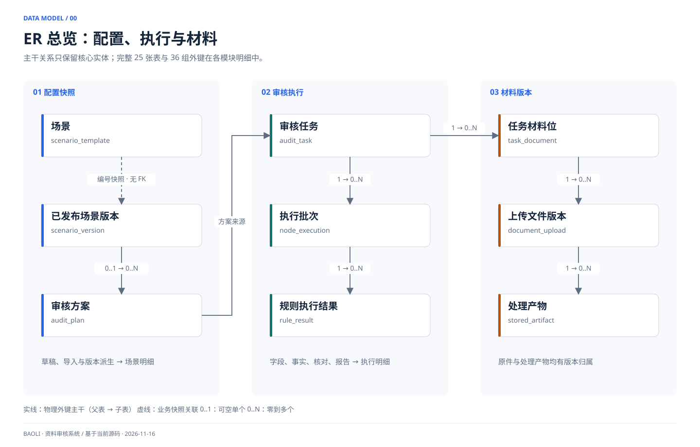

# 资料审核系统 ER 图

按仓库[目标 DDL](../backend/resource/schema.sql)静态核对，当前包含 26 张业务表、37 组物理外键。下方 Mermaid 与明细表已包含 `0010_operation_llm_response`。图册的 ER 图片是 2026-11-16 快照，未画出此次新增表和外键；运行数据库版本需另行核实。

[打开可切换图册](diagrams/资料审核系统图册.html) · [ER 总览 SVG](diagrams/资料审核系统ER图.svg) · [工作流说明](资料审核系统工作流.md)



## 读图约定

- 图册总览仅展示主干关系，实线为物理外键，虚线为业务快照关联。模块图用于定位；完整关系见本文下方的外键明细。
- 模块明细连线格式为 `R编号 父记录数 : 子记录数`。例如 `1 : 0..N` 表示每个子记录必须关联一个父记录，每个父记录可以关联零到多个子记录；`0..1` 表示可空单个。
- 图册中的 R 编号仅在当前页有效。图中覆盖旧版 36 组外键；后台操作到导入模型响应的一对多关系见本文 Mermaid。
- `PK` 为主键，`FK` 为外键成员，`UK` 为单列唯一键，字段后的 `?` 表示 SQL 可空。卡片只列定位字段；完整字段与约束以实体和 SQL 为准。复合外键的一条连线代表整组字段，不代表单列可以独立关联。
- 下方 Mermaid 为可编辑的完整关系源码。所有关系均为真实 FK；Mermaid 虚线表示非标识关系（子表有独立主键），不表示逻辑引用。

## 模块图索引

| 图 | 内容 | 外键组数 |
| --- | --- | --- |
| [场景、发布与方案](diagrams/er-scenarios.svg) | 草稿、导入、版本派生、方案和任务来源 | 9 |
| [任务材料与文件版本](diagrams/er-materials.svg) | 材料位、上传历史与处理产物 | 3 |
| [字段取值与人工记录](diagrams/er-values.svg) | 字段候选的来源与人工复核 | 6 |
| [统一事实与计算结果](diagrams/er-facts.svg) | 事实的任务、材料与执行归属 | 3 |
| [执行批次、规则结果与报告](diagrams/er-execution.svg) | 执行容器、批次、字段确认、结果和报告 | 8 |
| [AI 规则库编制](diagrams/er-generation.svg) | 编制、修订、对话、导出与导入 | 7 |
| [后台操作与报告模板](diagrams/er-support.svg) | 业务编号引用与任务风格快照 | 逻辑关系 |

明细图的可编辑 Graphviz 源码保存在同名 `.dot` 文件中。图册离线可用，不依赖外部接口。

## 业务结构与存储边界

场景草稿发布为不可变版本，审核方案保存可编辑副本，创建任务时冻结执行配置。任务下维护材料位、文件版本、执行批次、字段与事实索引、规则结果及报告。AI 规则库编制独立保存当前文档、修订、对话、冻结导出，再通过导入作业进入场景配置。

| 内容 | 当前存储位置 |
| --- | --- |
| 材料、字段、规则、计算与报告章节定义 | `scenario_draft.config_json`、`scenario_version.manifest_json`、`audit_plan.config_json / manifest_json`、`audit_task.manifest_json`，不是独立物理表 |
| 新任务的业务取值、规则处置和依据 | 当前事实在 `values/current/values.csv`，字段候选、历史和原文在 `values/history.json`，规则业务结果在 `rule_result.result_json`；清单在 `audit_task.value_file_json` |
| 字段与事实的身份、版本、当前位及状态 | `task_field_value`、`task_fact` |
| 规则名称、状态、风险等级及执行诊断 | `rule_result`；与取值 CSV 分工保存 |
| 审核报告正文与生成范围快照 | `audit_report.content_md / snapshot_json` |
| AI 编制当前文档与历史全文 | `rulebook_generation_job.document_json`、`rulebook_generation_revision.document_json`、`rulebook_generation_export.document_snapshot_json` |
| 规则库导入的原始模型响应 | `operation_llm_response` 按后台操作、阶段和文件相对路径登记；不使用旧的 `background_operation.raw_response_path` |

以下关联存在于业务逻辑或 JSON 快照中，**没有物理外键，未画入物理 ER 图**：

- `scenario_version.scenario_code`、`audit_plan.scenario_code` 保存场景标识；历史版本不通过 FK 依附场景身份。`scenario_draft.base_version_no` 也不是 FK。
- 任务选择报告模板时，将 `template_no`、名称和风格档案冻结到 `audit_task.manifest_json.report_generation`；`report_template` 与 `audit_report` 之间没有直接 FK。
- `background_operation`、`operation_log` 的 `object_type + object_no` 定位业务对象；`operation_log.command_no` 关联后台操作编号，但没有 FK。
- `rulebook_generation_export` 以 `generation_job_id + revision` 标识导出修订，但只对作业建 FK；没有对修订表建立复合 FK。
- `manual_review` 是已有物理表；通用人工裁决流程当前未启用。字段核对确认由 `field_review_confirmation` 记录。
- 当前没有独立用户、角色、Evidence 或 LangGraph checkpoint 表。`scenario_node` 当前用于执行记录技术容器，不表示任意业务节点编排。

## 完整 ER 图源码

<details>
<summary>展开完整 Mermaid 源码（包含全部关系，日常查看优先使用模块图）</summary>

```mermaid
erDiagram
    direction LR
    scenario_template ["场景 / scenario_template"] {
        bigint id PK
        string scenario_code UK
        string scenario_name
        int latest_version_no
    }
    scenario_draft ["场景草稿 / scenario_draft"] {
        bigint id PK
        string scenario_code FK, UK
        int revision_no
        json config_json
    }
    import_job ["规则库导入作业 / import_job"] {
        bigint id PK
        string scenario_code FK "可空"
        string job_no UK
        string status
        json proposals_json "可空"
    }
    scenario_version ["已发布场景版本 / scenario_version"] {
        bigint id PK
        bigint import_job_id FK, UK "可空"
        bigint base_version_id FK "可空"
        string scenario_code
        int version_no
        json manifest_json
    }
    scenario_node ["执行容器节点 / scenario_node"] {
        bigint id PK
        bigint scenario_version_id FK
        string node_code
        string node_type
        json config_json "可空"
    }
    audit_plan ["审核方案 / audit_plan"] {
        bigint id PK
        bigint scenario_version_id FK "可空"
        string plan_code UK
        string plan_name
        json config_json
        json manifest_json "可空"
    }
    audit_task ["审核任务 / audit_task"] {
        bigint id PK
        bigint scenario_version_id FK
        bigint plan_id FK "可空"
        string current_node FK
        string task_no UK
        string status
        int input_revision
        json manifest_json
        json value_file_json "可空"
    }
    node_execution ["执行批次 / node_execution"] {
        bigint id PK
        bigint audit_task_id FK
        bigint scenario_version_id FK
        string node_code FK
        int sequence_no
        string status
        json result_json "可空"
    }
    task_document ["任务材料位 / task_document"] {
        bigint id PK
        bigint audit_task_id FK
        string document_no UK
        string material_key
        string material_name
        string status
    }
    document_upload ["上传文件版本 / document_upload"] {
        bigint id PK
        bigint task_document_id FK
        bigint audit_task_id FK
        string upload_no
        bool is_current
        string relative_path
    }
    stored_artifact ["处理产物索引 / stored_artifact"] {
        bigint id PK
        bigint document_upload_id FK
        bigint audit_task_id FK
        string artifact_no UK
        string artifact_type
        string status
        string relative_path
    }
    task_field_value ["字段取值索引 / task_field_value"] {
        bigint id PK
        bigint audit_task_id FK
        bigint scenario_version_id FK
        string material_key FK
        bigint document_upload_id FK
        bigint extraction_execution_id FK "可空"
        string field_key
        int revision_no
        bool is_current
        string status
    }
    task_fact ["统一事实索引 / task_fact"] {
        bigint id PK
        bigint audit_task_id FK
        bigint scenario_version_id FK
        string material_key FK "可空"
        bigint source_execution_id FK "可空"
        string fact_code
        string fact_kind
        int revision_no
        bool is_current
    }
    rule_result ["规则执行结果 / rule_result"] {
        bigint id PK
        bigint audit_task_id FK
        bigint node_execution_id FK
        string rule_key
        string rule_code "可空"
        string rule_name
        string status
        string risk_level "可空"
    }
    manual_review ["人工复核记录 / manual_review"] {
        bigint id PK
        bigint audit_task_id FK
        bigint field_value_id FK
        string review_no UK
        string decision "可空"
        text, before_value "可空"
        text, after_value "可空"
    }
    field_review_confirmation ["字段核对确认 / field_review_confirmation"] {
        bigint id PK
        bigint audit_task_id FK
        bigint node_execution_id FK
        string confirmation_no UK
        int input_revision
        string field_digest
    }
    audit_report ["审核报告快照 / audit_report"] {
        bigint id PK
        bigint audit_task_id FK
        bigint node_execution_id FK "可空"
        string report_no UK
        string report_name
        int input_revision "可空"
        mediumtext, content_md "可空"
        json snapshot_json "可空"
    }
    rulebook_generation_job ["AI规则库编制作业 / rulebook_generation_job"] {
        bigint id PK
        string job_no UK
        int revision
        json document_json "可空"
    }
    rulebook_generation_revision ["编制修订快照 / rulebook_generation_revision"] {
        bigint id PK
        bigint generation_job_id FK
        bigint operation_id FK, UK "可空"
        int revision
        string origin
        json document_json
    }
    rulebook_generation_message ["编制对话消息 / rulebook_generation_message"] {
        bigint id PK
        bigint generation_job_id FK
        int revision FK
        bigint operation_id FK
        string role
        text content
    }
    rulebook_generation_export ["编制冻结导出 / rulebook_generation_export"] {
        bigint id PK
        bigint generation_job_id FK
        string export_no UK
        int revision
        json document_snapshot_json
    }
    rulebook_generation_import ["编制导入关联 / rulebook_generation_import"] {
        bigint id PK
        bigint generation_export_id FK
        bigint import_job_id FK, UK "可空"
        string idempotency_key
    }
    background_operation ["后台操作 / background_operation"] {
        bigint id PK
        string operation_no UK
        string object_type
        string object_no
        string phase "可空"
        string status
    }
    operation_llm_response ["导入模型响应 / operation_llm_response"] {
        bigint id PK
        bigint operation_id FK
        string stage
        string relative_path UK
    }
    operation_log ["业务操作日志 / operation_log"] {
        bigint id PK
        string log_no UK
        string object_type
        string object_no
        string command_no "可空"
        string result
    }
    report_template ["报告风格模板 / report_template"] {
        bigint id PK
        string template_no UK
        string name
        string status
        json style_profile_json "可空"
    }
    scenario_template |o..o{ import_job : "scenario_code"
    scenario_version |o..o{ scenario_version : "base_version_id"
    import_job |o..o| scenario_version : "import_job_id"
    scenario_version ||..o{ scenario_node : "scenario_version_id"
    scenario_template ||..o| scenario_draft : "scenario_code"
    scenario_version |o..o{ audit_plan : "scenario_version_id"
    scenario_node ||..o{ audit_task : "scenario_version_id, current_node"
    audit_plan |o..o{ audit_task : "plan_id"
    scenario_version ||..o{ audit_task : "scenario_version_id"
    audit_task ||..o{ node_execution : "audit_task_id, scenario_version_id"
    scenario_node ||..o{ node_execution : "scenario_version_id, node_code"
    node_execution |o..o{ audit_report : "node_execution_id, audit_task_id"
    audit_task ||..o{ audit_report : "audit_task_id"
    audit_task ||..o{ task_document : "audit_task_id"
    task_document ||..o{ document_upload : "task_document_id, audit_task_id"
    document_upload ||..o{ stored_artifact : "document_upload_id, audit_task_id"
    node_execution |o..o{ task_field_value : "extraction_execution_id, audit_task_id"
    task_document ||..o{ task_field_value : "audit_task_id, material_key"
    audit_task ||..o{ task_field_value : "audit_task_id, scenario_version_id"
    document_upload ||..o{ task_field_value : "document_upload_id, audit_task_id"
    node_execution |o..o{ task_fact : "source_execution_id, audit_task_id"
    task_document |o..o{ task_fact : "audit_task_id, material_key"
    audit_task ||..o{ task_fact : "audit_task_id, scenario_version_id"
    node_execution ||..o{ rule_result : "node_execution_id, audit_task_id"
    audit_task ||..o{ rule_result : "audit_task_id"
    task_field_value ||..o{ manual_review : "field_value_id, audit_task_id"
    audit_task ||..o{ manual_review : "audit_task_id"
    node_execution ||..o{ field_review_confirmation : "node_execution_id, audit_task_id"
    audit_task ||..o{ field_review_confirmation : "audit_task_id"
    rulebook_generation_job ||..o{ rulebook_generation_export : "generation_job_id"
    rulebook_generation_export ||..o{ rulebook_generation_import : "generation_export_id"
    import_job |o..o| rulebook_generation_import : "import_job_id"
    rulebook_generation_job ||..o{ rulebook_generation_revision : "generation_job_id"
    background_operation |o..o| rulebook_generation_revision : "operation_id"
    background_operation ||..o{ rulebook_generation_message : "operation_id"
    background_operation ||..o{ operation_llm_response : "operation_id"
    rulebook_generation_revision ||..o{ rulebook_generation_message : "generation_job_id, revision"
```

</details>

## 外键与基数明细

下表按数据库约束列出全部外键。父记录数指每条子记录可关联的父记录数；子记录数指每条父记录可被多少条子记录关联。复合 FK 允许 NULL 时，未组成完整非空键的行不要求存在父记录。

| 子表 | 外键列 | 父表及引用列 | 父记录数 | 子记录数 |
| --- | --- | --- | --- | --- |
| `import_job` | `scenario_code` | `scenario_template(scenario_code)` | 0..1 | 0..N |
| `scenario_version` | `base_version_id` | `scenario_version(id)` | 0..1 | 0..N |
| `scenario_version` | `import_job_id` | `import_job(id)` | 0..1 | 0..1 |
| `scenario_node` | `scenario_version_id` | `scenario_version(id)` | 1 | 0..N |
| `scenario_draft` | `scenario_code` | `scenario_template(scenario_code)` | 1 | 0..1 |
| `audit_plan` | `scenario_version_id` | `scenario_version(id)` | 0..1 | 0..N |
| `audit_task` | `scenario_version_id, current_node` | `scenario_node(scenario_version_id, node_code)` | 1 | 0..N |
| `audit_task` | `plan_id` | `audit_plan(id)` | 0..1 | 0..N |
| `audit_task` | `scenario_version_id` | `scenario_version(id)` | 1 | 0..N |
| `node_execution` | `audit_task_id, scenario_version_id` | `audit_task(id, scenario_version_id)` | 1 | 0..N |
| `node_execution` | `scenario_version_id, node_code` | `scenario_node(scenario_version_id, node_code)` | 1 | 0..N |
| `audit_report` | `node_execution_id, audit_task_id` | `node_execution(id, audit_task_id)` | 0..1 | 0..N |
| `audit_report` | `audit_task_id` | `audit_task(id)` | 1 | 0..N |
| `task_document` | `audit_task_id` | `audit_task(id)` | 1 | 0..N |
| `document_upload` | `task_document_id, audit_task_id` | `task_document(id, audit_task_id)` | 1 | 0..N |
| `stored_artifact` | `document_upload_id, audit_task_id` | `document_upload(id, audit_task_id)` | 1 | 0..N |
| `task_field_value` | `extraction_execution_id, audit_task_id` | `node_execution(id, audit_task_id)` | 0..1 | 0..N |
| `task_field_value` | `audit_task_id, material_key` | `task_document(audit_task_id, material_key)` | 1 | 0..N |
| `task_field_value` | `audit_task_id, scenario_version_id` | `audit_task(id, scenario_version_id)` | 1 | 0..N |
| `task_field_value` | `document_upload_id, audit_task_id` | `document_upload(id, audit_task_id)` | 1 | 0..N |
| `task_fact` | `source_execution_id, audit_task_id` | `node_execution(id, audit_task_id)` | 0..1 | 0..N |
| `task_fact` | `audit_task_id, material_key` | `task_document(audit_task_id, material_key)` | 0..1 | 0..N |
| `task_fact` | `audit_task_id, scenario_version_id` | `audit_task(id, scenario_version_id)` | 1 | 0..N |
| `rule_result` | `node_execution_id, audit_task_id` | `node_execution(id, audit_task_id)` | 1 | 0..N |
| `rule_result` | `audit_task_id` | `audit_task(id)` | 1 | 0..N |
| `manual_review` | `field_value_id, audit_task_id` | `task_field_value(id, audit_task_id)` | 1 | 0..N |
| `manual_review` | `audit_task_id` | `audit_task(id)` | 1 | 0..N |
| `field_review_confirmation` | `node_execution_id, audit_task_id` | `node_execution(id, audit_task_id)` | 1 | 0..N |
| `field_review_confirmation` | `audit_task_id` | `audit_task(id)` | 1 | 0..N |
| `rulebook_generation_export` | `generation_job_id` | `rulebook_generation_job(id)` | 1 | 0..N |
| `rulebook_generation_import` | `generation_export_id` | `rulebook_generation_export(id)` | 1 | 0..N |
| `rulebook_generation_import` | `import_job_id` | `import_job(id)` | 0..1 | 0..1 |
| `rulebook_generation_revision` | `generation_job_id` | `rulebook_generation_job(id)` | 1 | 0..N |
| `rulebook_generation_revision` | `operation_id` | `background_operation(id)` | 0..1 | 0..1 |
| `rulebook_generation_message` | `operation_id` | `background_operation(id)` | 1 | 0..N |
| `operation_llm_response` | `operation_id` | `background_operation(id)` | 1 | 0..N |
| `rulebook_generation_message` | `generation_job_id, revision` | `rulebook_generation_revision(generation_job_id, revision)` | 1 | 0..N |

合计 37 组外键；复合外键按组计数。

## 唯一键明细

所有表主键均为 `id`。下表完整列出 SQL 中的唯一键组合；每一组括号代表一条独立约束。

| 表 | 唯一键组合 |
| --- | --- |
| `scenario_template` | `(scenario_code)` |
| `background_operation` | `(operation_no)`；`(object_type, object_no, operation_type, idempotency_key)` |
| `operation_llm_response` | `(relative_path)` |
| `import_job` | `(job_no)` |
| `scenario_version` | `(scenario_code, version_no)`；`(import_job_id)` |
| `scenario_node` | `(scenario_version_id, node_code)`；`(scenario_version_id, sequence_no)` |
| `scenario_draft` | `(scenario_code)` |
| `audit_plan` | `(plan_code)` |
| `operation_log` | `(log_no)`；`(object_type, operation_type, idempotency_key)` |
| `audit_task` | `(task_no)`；`(id, scenario_version_id)` |
| `node_execution` | `(audit_task_id, sequence_no)`；`(id, audit_task_id)` |
| `audit_report` | `(report_no)` |
| `report_template` | `(template_no)`；`(upload_idempotency_key)` |
| `task_document` | `(document_no)`；`(audit_task_id, material_key)`；`(id, audit_task_id)` |
| `document_upload` | `(task_document_id, upload_no)`；`(id, task_document_id)`；`(id, audit_task_id)`；`(current_task_document_id)` |
| `stored_artifact` | `(artifact_no)`；`(id, audit_task_id)`；`(document_upload_id, artifact_type)` |
| `task_field_value` | `(audit_task_id, field_key, material_key, document_upload_id, revision_no)`；`(id, audit_task_id)`；`(audit_task_id, current_fact_scope)` |
| `task_fact` | `(id, audit_task_id)`；`(audit_task_id, fact_code, material_scope, period_scope, statement_scope, entity_scope, revision_no)`；`(audit_task_id, current_fact_scope)` |
| `rule_result` | `(node_execution_id, rule_key)`；`(id, audit_task_id)` |
| `manual_review` | `(review_no)` |
| `field_review_confirmation` | `(confirmation_no)` |
| `rulebook_generation_job` | `(job_no)`；`(idempotency_key)` |
| `rulebook_generation_export` | `(export_no)`；`(generation_job_id, revision)` |
| `rulebook_generation_import` | `(generation_export_id, idempotency_key)`；`(import_job_id)` |
| `rulebook_generation_revision` | `(generation_job_id, revision)`；`(operation_id)` |
| `rulebook_generation_message` | `(operation_id, role)` |

`document_upload.current_task_document_id`、`task_field_value.current_fact_scope`、`task_fact.material_scope / current_fact_scope` 为生成列；相关唯一键约束当前版本或事实范围，不是额外实体。

维护本图时，先核对 ORM 与 `schema.sql` 的表、可空列、唯一键及复合外键，再同步 Mermaid 与图片；不要将 dataclass、JSON 子对象或文件清单自动视为表。
