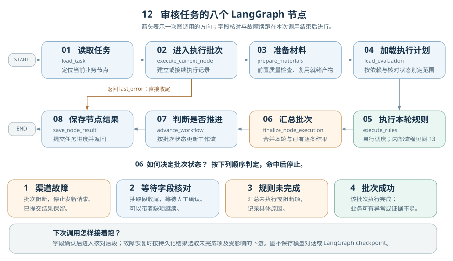
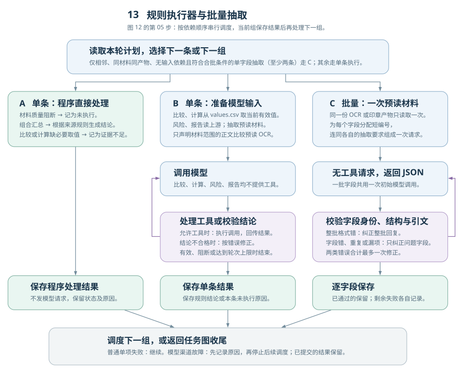

# 资料审核系统工作流

业务过程、程序总览和执行细图分开呈现。节点细图按 2026-11-18 的 `dev2` 源码静态核对。

[打开 ER 与工作流图册](diagrams/资料审核系统图册.html) · [查看 ER 图说明](资料审核系统ER图.md)

## 业务全流程

[打开 SVG](diagrams/workflow-business.svg)

AI 编制是可选的业务文档整理环节，导入解析才转换系统执行配置。导出后选择场景创建导入作业，检查并保存草稿，再发布版本。用户以版本建立方案，创建任务时冻结方案配置；后续编辑不会改写旧任务。

## 审核执行流程

[打开 SVG](diagrams/workflow-audit.svg) · [打开 PNG](diagrams/workflow-audit.png)

- 原文件质量检查按生效规则执行。受阻文件停止后续处理，相关抽取与依赖规则记录未执行原因，无关材料继续；依赖正文或印章的质量要求仍在处理后检查。
- 获准文件先经过 8018 材料类型校验，再并行执行去章和印章识别；去章完成后立即进入 OCR。技术处理失败保留已完成产物，其他分支收尾后阻断审核。
- 有字段抽取时，抽取段结束进入 `WAITING_FIELD_REVIEW`。只保存字段修改仍处于等待；确认后记录输入修订与字段摘要，在同一批次继续后续规则。没有抽取项时不建立空的核对步骤。
- 计算、检查、风险和报告按真实依赖执行。图中合为一组，不表示固定的四阶段顺序；报告也取决于生效规则。
- 模型渠道故障停止后续请求并保存已形成的结果。符合恢复条件的批次，根据已提交结果继续未完成项及受影响下游；已经关闭的抽取段不会因确认继续而重抽。
- 执行完成与业务通过分别判断。字段确认不代表材料真实或审核通过。

## 程序执行结构

[打开 SVG](diagrams/workflow-runtime.svg)

任务图固定八个节点。`execute_rules` 按依赖安排规则。组合汇总由程序直接计算；材料质量受阻或比较、计算缺少必要输入时，程序直接记录原因。其余规则按类型进入单条模型执行或批量抽取；哪些路径允许调用工具见下方逐规则执行器图。

图状态 `AuditGraphState` 只在当次调用中使用，没有持久化 checkpoint。恢复依据是执行批次、持久化规则结果及字段确认，而不是恢复旧模型消息。

## 审核任务：LangGraph 节点

[打开 SVG](diagrams/workflow-langgraph-task.svg) · [编辑 DOT](diagrams/workflow-langgraph-task.dot)

上半部分的箭头是 LangGraph 注册的边，下半部分按优先级列出第 06 步的收尾判断。`execute_current_node` 返回 `last_error` 时直达 `save_node_result`；抛出的异常由调用边界报告。字段核对等待和渠道阻断是批次状态，同一次调用仍会走收尾节点。字段确认和继续执行走图外服务，按已提交的结果恢复。

## `execute_rules` 内部：规则执行器

[打开 SVG](diagrams/workflow-rule-runner.svg) · [编辑 DOT](diagrams/workflow-rule-runner.dot)

图中 A 是程序直接处理：材料质量阻断、组合汇总，以及比较或计算缺少必要取值。B 是单条模型执行：比较和计算使用当前有效事实，风险和报告读取上游，四类都不提供工具。C 是批量抽取。合批抽取也不提供工具，整批格式错误或字段漏项、重复及校验错误共用一次修正机会。渠道中断时，执行器保存未完成原因并把故障交给外层暂停调度。

审查效率时可重点看两处：`execute_rules` 的串行调度，以及候选结论不合格时回到模型的分支。模型响应中断导致后续规则暂停的路径也在同一张图里标出。

## 源码依据

| 内容 | 源码 |
| --- | --- |
| 固定任务图与规则调度 | `backend/app/graphs/audit_graph.py` |
| 单条规则的模型、工具循环 | `backend/app/graphs/audit_rule_runner.py` |
| 批量抽取及修正 | `backend/app/modules/audit/execution/service/flow/extraction_batch.py` |
| 候选结论校验与保存 | `backend/app/modules/audit/execution/service/flow/results.py` |
| 前置材料检查与计划加载 | `backend/app/modules/audit/execution/service/flow/context.py` |
| 材料并行流水线 | `backend/app/modules/audit/artifact/preprocessing.py` |
| 抽取与核对后的执行边界 | `backend/app/modules/audit/execution/service/flow/plan.py` |
| 批次汇总、等待与任务推进 | `backend/app/modules/audit/execution/service/flow/lifecycle.py` |
| 恢复资格与重跑范围 | `backend/app/modules/audit/execution/service/resume.py` |
| 任务配置与模板风格冻结 | `backend/app/modules/audit/task/service/creation.py` |

SVG 文件保留可编辑的文字、节点与连线。完整业务约定见 [业务逻辑](业务逻辑.md) 和 [规则库与审核执行契约](规则库与审核执行契约.md)。
