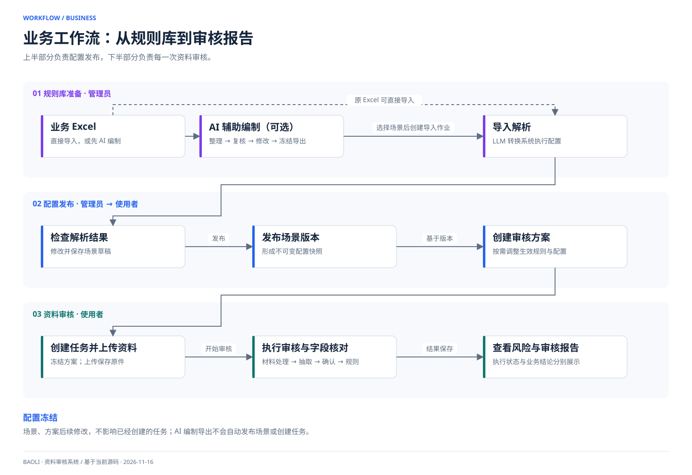
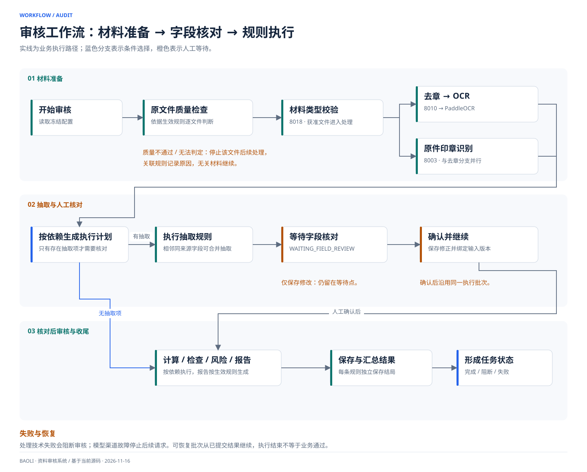
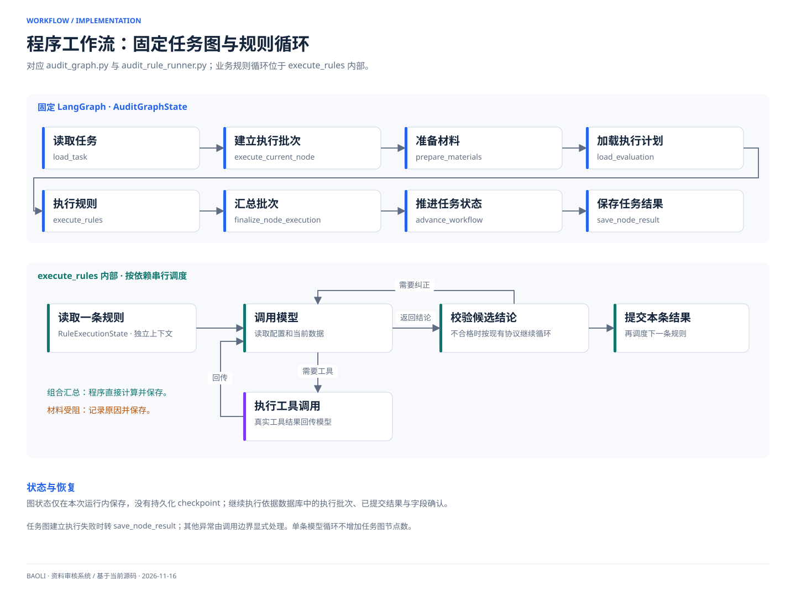
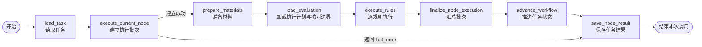

# 资料审核系统工作流

按 2026-11-16 当前源码静态梳理。业务过程与程序调用结构分图展示，未运行审核或调用外部服务。

[打开 ER 与工作流图册](diagrams/资料审核系统图册.html) · [查看 ER 图说明](资料审核系统ER图.md)

## 业务全流程

[打开 SVG](diagrams/workflow-business.svg)

AI 编制是可选的业务文档整理环节，导入解析才转换系统执行配置。导出后选择场景创建导入作业，检查并保存草稿，再发布版本。用户以版本建立方案，创建任务时冻结方案配置；后续编辑不会改写旧任务。

## 审核执行流程

[打开 SVG](diagrams/workflow-audit.svg) · [打开 PNG](diagrams/workflow-audit.png)

- 原文件质量检查按生效规则执行。受阻文件停止后续处理，相关抽取与依赖规则记录未执行原因，无关材料继续；依赖正文或印章的质量要求仍在处理后检查。
- 获准文件先经过 8018 材料类型校验，再并行执行去章和印章识别；去章完成后立即进入 OCR。技术处理失败保留已完成产物，其他分支收尾后阻断审核。
- 有字段抽取时，抽取段结束进入 `WAITING_FIELD_REVIEW`。只保存字段修改仍处于等待；确认后记录输入修订与字段摘要，在同一批次继续后续规则。没有抽取项时不建立空的核对步骤。
- 计算、检查、风险和报告按真实依赖执行。图中合为一组，不表示固定的四阶段顺序；报告也取决于生效规则。
- 模型渠道故障停止后续请求并保存已形成的结果。符合恢复条件的批次，根据已提交结果继续未完成项及受影响下游；已经关闭的抽取段不会因确认继续而重抽。
- 执行完成与业务通过分别判断。字段确认不代表材料真实或审核通过。

## 程序执行结构

[打开 SVG](diagrams/workflow-runtime.svg)

任务图固定八个节点。`execute_rules` 按依赖串行遍历规则，单条规则使用独立 `RuleExecutionState` 执行模型与工具循环；相邻同材料同来源的合格抽取项可以合批。组合汇总直接由程序计算。

图状态 `AuditGraphState` 只在当次调用中使用，没有持久化 checkpoint。恢复依据是执行批次、持久化规则结果及字段确认，而不是恢复旧模型消息。

可编辑的实际任务图：

以上 Mermaid 对应图内节点及路由，未将方法内部处理步骤展开。未处理异常由外层调用边界显式报告。

## 源码依据

| 内容 | 源码 |
| --- | --- |
| 固定任务图与规则调度 | `backend/app/graphs/audit_graph.py` |
| 单条规则的模型、工具循环 | `backend/app/graphs/audit_rule_runner.py` |
| 前置材料检查与计划加载 | `backend/app/modules/audit/execution/service/flow/context.py` |
| 材料并行流水线 | `backend/app/modules/audit/artifact/preprocessing.py` |
| 抽取与核对后的执行边界 | `backend/app/modules/audit/execution/service/flow/plan.py` |
| 批次汇总、等待与任务推进 | `backend/app/modules/audit/execution/service/flow/lifecycle.py` |
| 恢复资格与重跑范围 | `backend/app/modules/audit/execution/service/resume.py` |
| 任务配置与模板风格冻结 | `backend/app/modules/audit/task/service/creation.py` |

SVG 文件保留可编辑的文字、节点与连线。完整业务约定见 [业务逻辑](业务逻辑.md) 和 [规则库与审核执行契约](规则库与审核执行契约.md)。
